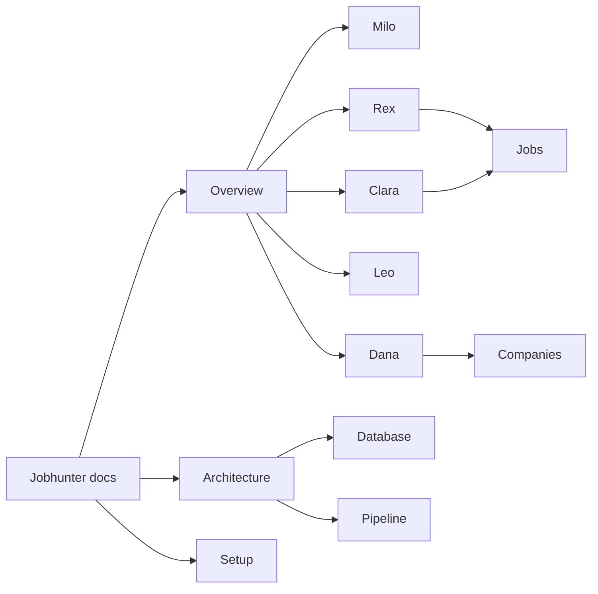

# Jobhunter docs

專案說明全部放在這個資料夾。倉庫根目錄與 `frontend/` 只留啟動摘要；完整舊文在 [[Root README]]、[[Frontend README]]。

## 地圖

Obsidian 圖裡，公司卡在 `Companies/`、職缺卡在 `Jobs/`、技能卡在 `Skills/`。代理筆記用 `[[Companies]]` 資料夾內的公司名連結，例如 `[[ATAL Technologies Ltd.安樂科技工程有限公司]]` 只在該筆記存在時才有效。

## 核心

- [[Overview]] — 這條管線解決什麼
- [[Architecture]] — 共享函式庫與資料流
- [[Pipeline]] — 閘門與狀態欄位
- [[Setup]] — 安裝、`.env`、啟動
- [[Usage]] — CLI 與儀表板操作
- [[Database]] — `job_agent.db` 表
- [[Dashboard]] — 像素辦公室
- [[Privacy]] — 去識別化與 ground-truth
- [[Automation]] — 排程與 Telegram
- [[Interview]] — 面試口述（全文 [[Interview tech stack]]）

## 代理

- [[Milo]] — PAC、本機 Ollama
- [[Rex]] — 搜尋與雙分數
- [[Dana]] — 僱主背調
- [[Leo]] — 履歷 PDF
- [[Clara]] — 申請包

## 舊文（全文歸檔）

- [[Root README]]
- [[Frontend README]]
- [[Interview tech stack]]
